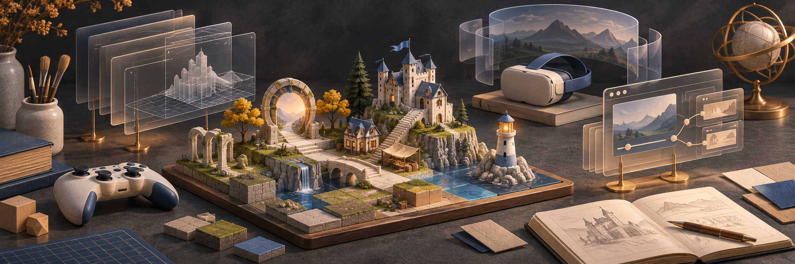

# Unity Clicker · 클리커 게임 학습 예제

공통 소개 이미지 · AI로 제작한 컨셉 아트이며 실제 프로젝트 실행 화면이 아닙니다.

**클릭 한 번의 보상에서 자동 수익과 강화, 저장까지 연결하는 Unity·C# 예제입니다.**

Unity UI 버튼, 게임 상태 관리, 코루틴과 로컬 저장을 작은 게임 루프로 살펴볼 수 있는 교육용 프로젝트입니다.

## 게임 루프

클릭으로 골드 획득 → 강화 구매로 클릭 보상 증가 → 아이템 구매로 초당 수익 발생 → 진행 상태 저장.

| 구성 | 코드에서 다루는 내용 |
| --- | --- |
| 클릭 보상 | `ClickButton`이 클릭당 골드를 조회하고 더함 |
| 강화 | `UpgradeButton`이 비용·레벨·보상 증가 처리 |
| 자동 수익 | `ItemButton`의 코루틴이 구매한 아이템 수익을 1초마다 지급 |
| 상태와 저장 | `DataController`가 골드·강화·아이템 정보를 `PlayerPrefs`로 저장·복원 |
| 화면 | `UIManager`가 골드, 클릭당 골드와 초당 수익 표시 |

## 열어보기

1. 저장소를 내려받고 Unity Hub에서 프로젝트 폴더를 추가합니다.
2. 기록된 에디터 버전 **Unity 2020.3.24f1**로 엽니다.
3. [`Assets/Scenes/SampleScene.unity`](Assets/Scenes/SampleScene.unity)를 열고 Play를 누릅니다.
4. 클릭·강화·아이템 구매 흐름과 재실행 시 저장 상태를 확인합니다.

이 문서 정리에서는 에디터 실행을 검증하지 않았습니다. 다른 Unity 버전에서 열면 변환이 발생할 수 있으니 복사본에서 확인하세요.

## 코드 읽는 순서

[ClickButton.cs](Assets/Script/ClickButton.cs) → [DataController.cs](Assets/Script/DataController.cs) → [UpgradeButton.cs](Assets/Script/UpgradeButton.cs) → [ItemButton.cs](Assets/Script/ItemButton.cs) → [UIManager.cs](Assets/Script/UIManager.cs).

저장 데이터는 `PlayerPrefs`에 남습니다. 골드와 업그레이드 상태가 초기 실행과 다를 수 있습니다. 일부 기존 코드의 한국어 주석은 문자 인코딩에 따라 깨져 보일 수 있습니다.

---

[김인권 · GitHub](https://github.com/ingunbi) · [전체 프로젝트](https://inkwonworks.ingunbi.workers.dev/) · [IceCubeLab](https://www.icecubelab.com/)
